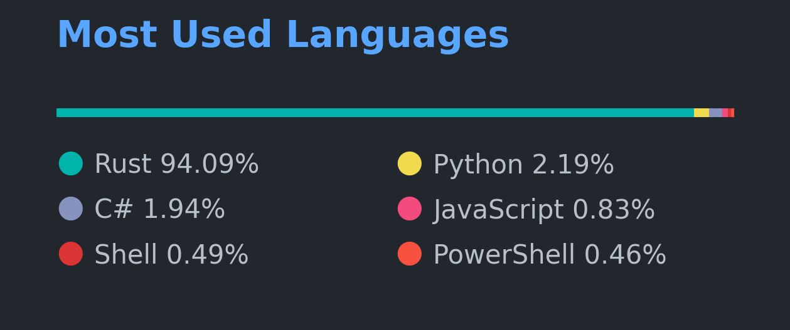

# Hi, I'm Hugo Nascimento 👋

I'm a developer driven by curiosity and by the challenge of solving real
problems. I enjoy understanding how systems work, designing clear
architectures, and turning complex ideas into practical software.

## Areas I'm exploring

- **Systems programming and software architecture** with Rust
- **Cross-platform desktop applications** with Tauri, React, and TypeScript
- **Parametric 3D CAD** and digital tools for woodworking and furniture design
- **AI-assisted engineering, automation, and MCP integrations**
- **Software security, data protection, and reverse engineering**

## Current focus

I'm exploring a CAD workflow for woodworking and furniture design, combining
accessible 3D modeling with dimensional precision. This ongoing work includes
evaluating and experimenting with third-party CAD technologies.

## How I approach software

I value specification-driven development, explicit architectural decisions, and
meaningful tests. I use AI tools as engineering collaborators for research,
design, implementation, and debugging—not as substitutes for understanding,
validation, or sound engineering decisions.

## Technologies

`Rust` · `TypeScript` · `JavaScript` · `Python` · `React` · `Tauri` · `MCP`

## My contributions

<picture>
  <source media="(prefers-color-scheme: dark)" srcset="assets/snake-dark.svg" />
  <source media="(prefers-color-scheme: light)" srcset="assets/snake.svg" />
  
</picture>

## GitHub activity

*Language statistics are automatically updated.*
