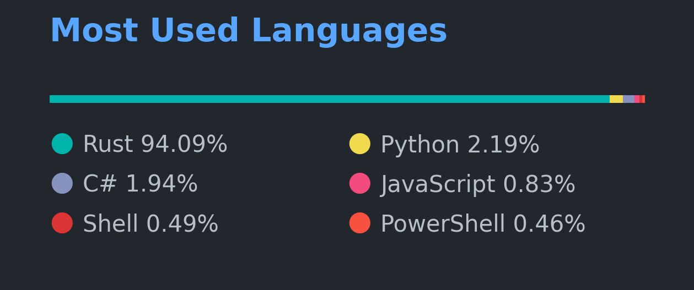

# Hugo Nascimento 😎

Sou um desenvolvedor movido pela curiosidade e pelo desafio de resolver
problemas reais. Gosto de entender como os sistemas funcionam, projetar
arquiteturas claras e transformar ideias complexas em software prático.

## Áreas que estou explorando

- **Programação de sistemas e arquitetura de software** com Rust
- **Aplicações desktop multiplataforma** com Tauri, React e TypeScript
- **CAD 3D paramétrico** e ferramentas digitais para marcenaria e design de móveis
- **Engenharia assistida por IA, automação e integrações com MCP**
- **Segurança de software, proteção de dados e engenharia reversa**

## Foco atual

Estou explorando um fluxo de trabalho de CAD para marcenaria e design de móveis,
combinando modelagem 3D acessível com precisão dimensional. Esse trabalho em
andamento inclui avaliar e experimentar tecnologias CAD de terceiros.

## Como abordo o desenvolvimento de software

Valorizo o desenvolvimento orientado por especificações, decisões arquiteturais
explícitas e testes significativos. Uso ferramentas de IA como colaboradoras de
engenharia em pesquisa, design, implementação e depuração — não como substitutas
da compreensão, validação ou de boas decisões de engenharia.

## Tecnologias

`Rust` · `TypeScript` · `JavaScript` · `Python` · `React` · `Tauri` · `MCP`

## Minhas contribuições

<picture>
  <source media="(prefers-color-scheme: dark)" srcset="assets/snake-dark.svg" />
  <source media="(prefers-color-scheme: light)" srcset="assets/snake.svg" />
  
</picture>

## Atividade no GitHub

*As estatísticas de linguagens são atualizadas automaticamente.*
